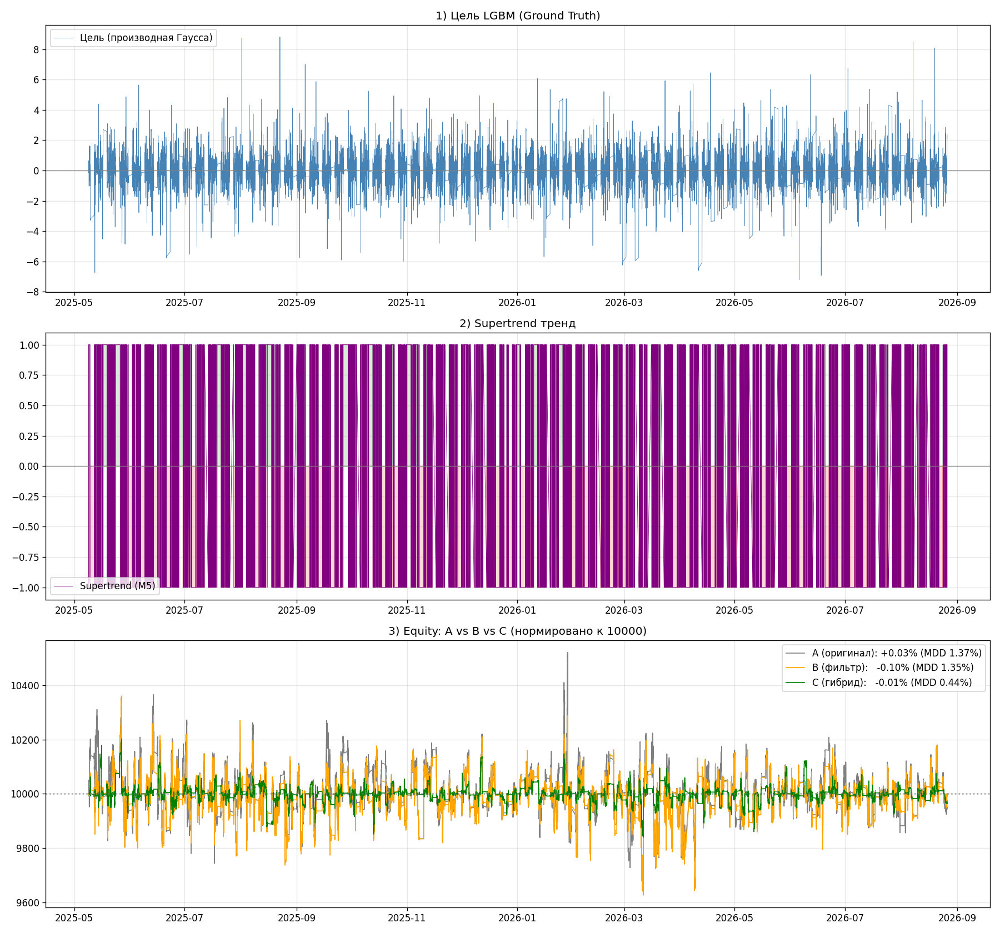
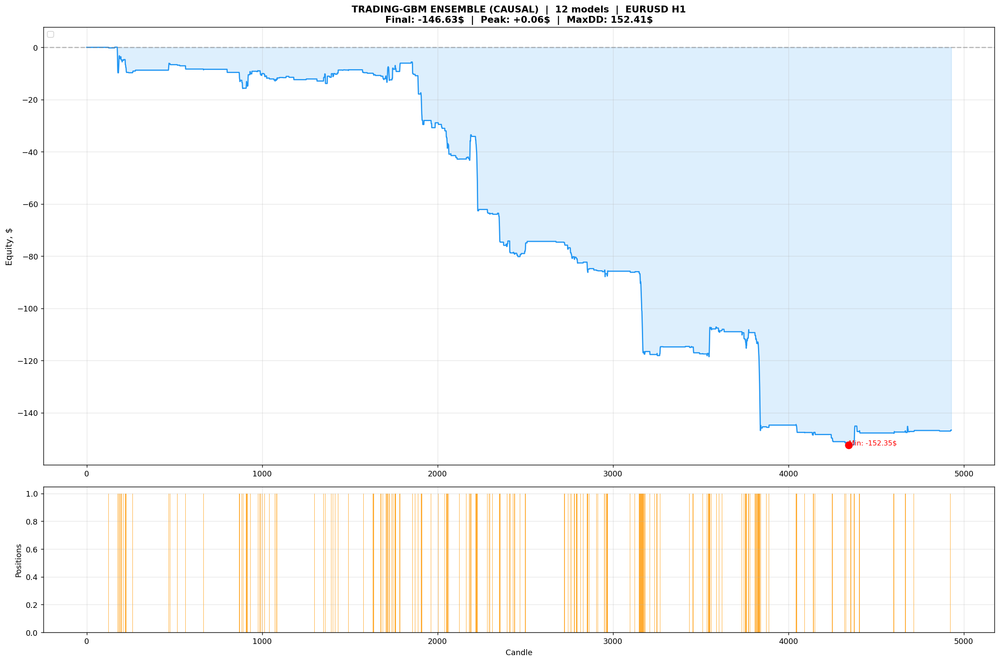
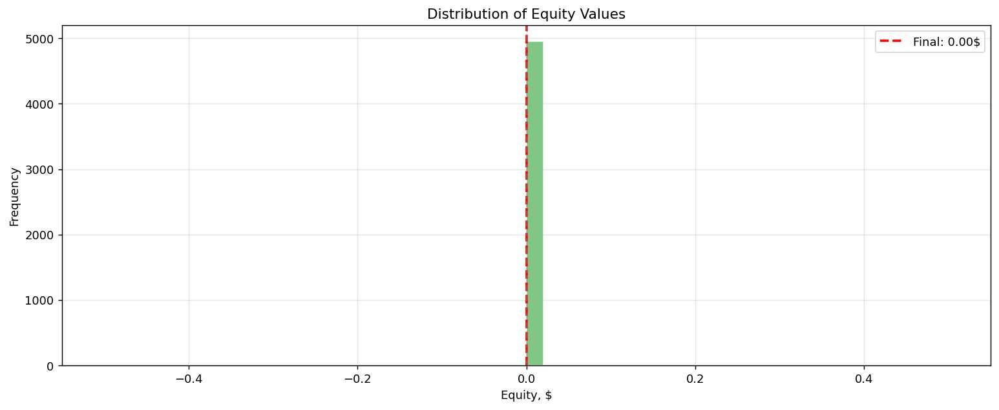
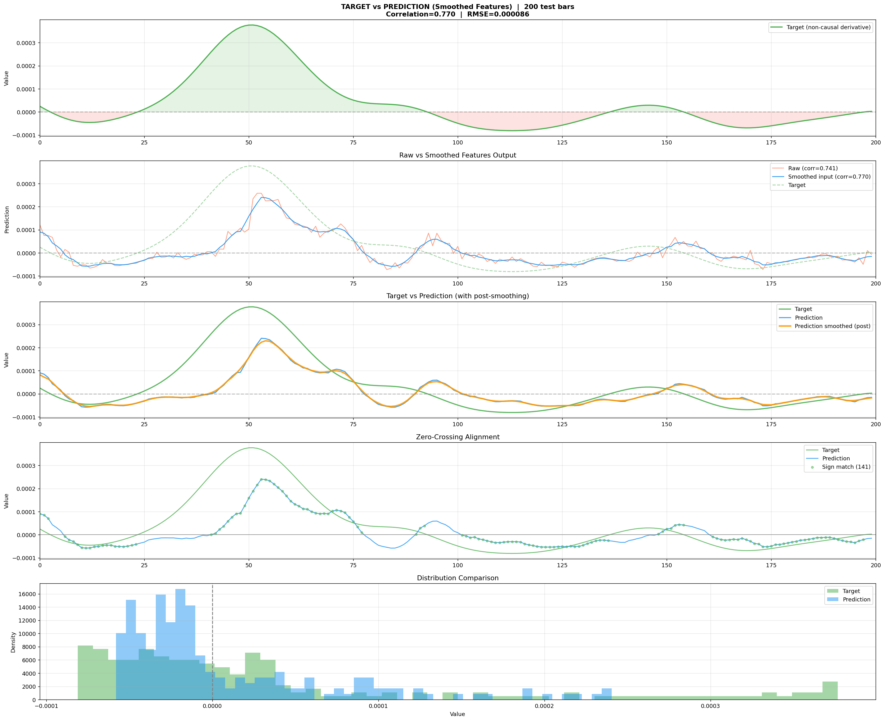
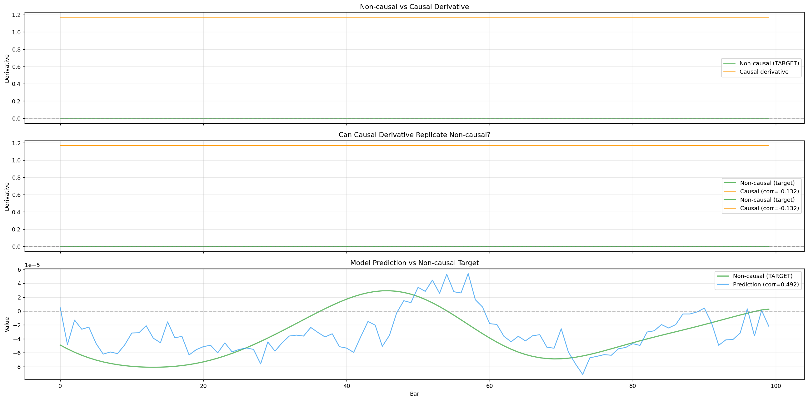
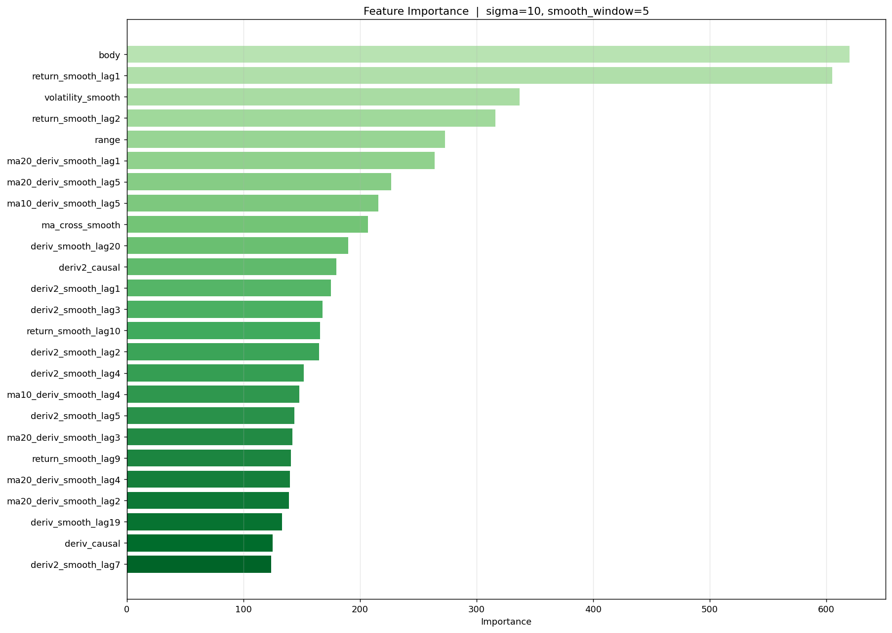
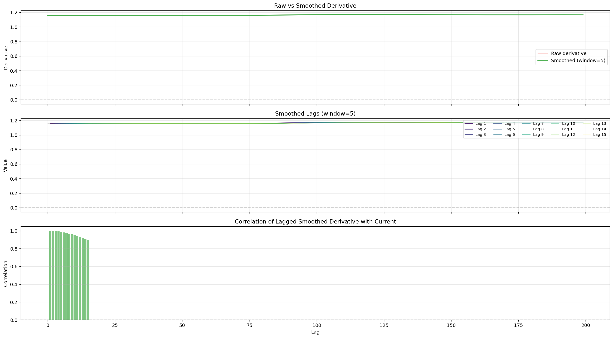
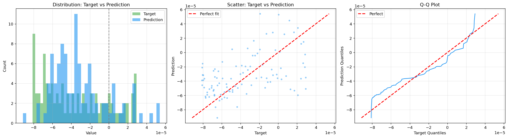
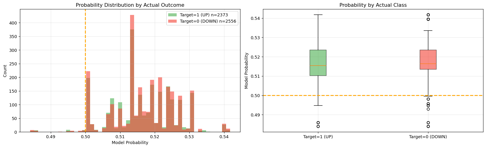

# Фичи со всех ТФ (multi-tf-features)

Проект: **строго каузальные признаки со всех таймфреймов** (M5 → D1) + LightGBM, который предсказывает **первую производную гауссова сглаживания цены** — и торговые варианты на этой идее: от чистой регрессии производной до гибрида Supertrend + LGBM и живого режима через MetaTrader 5.

## Описание системы на словах

### 1. Что предсказываем

Цена сглаживается ядром Гаусса (`σ = 5…30`), берётся первая производная — получается «чистый тренд», очищенный от шума. Она **некаузальная**: в момент `t` для неё нужны будущие цены. Модель учится её **приближать по прошлому**: на вход — только каузальные признаки, на выход — производная (регрессия) или её знак/сигнал (классификация).

### 2. Признаки со всех ТФ (ядро проекта)

Загружаются котировки M5, M15, M30, H1, H4, D1 и с базового таймфрейма строятся признаки, а старшие ТФ присоединяются как отдельные колонки. Правила строгой каузальности (из `build_strict.py`):

1. признак бара `t` использует только интервал `[0..t]` — только `rolling(..., min_periods=window)`;
2. никаких «глядящих вперёд» EMA/MACD/RSI — всё через causal-EMA и скользящие окна;
3. **без лагов таргета** — именно они давали основную утечку («зaval»);
4. walk-forward разбиение по времени, без перемешивания;
5. старшие ТФ: ресемпл → `ffill` → **`shift(1)`**, чтобы бар `t` видел только прошлые значения вышестоящего ТФ.

Дальше эта схема развивалась: версии с лагами (`build_strict-MT5-2-лаги.py`), со статистикой и бустингом (`…-статистика-бустинг.py`), с бинарным сигналом и полной торговлей (`…-бинарный-торговля*.py`), с подключением к живому MT5 (`…-MT5.py`, `mt5-deepseek.py`, `eurusd_derivative_forecaster_мой_китаец.py`, `лушая-мой-кит*.py`).

### 3. Три линии исследований

- **Регрессия производной** — `build_strict*.py`, `111*.py`, `коволюция-от-fable5*.py`: цель = производная, метрика — точность повторения формы; `111-5.py` подбирает гиперпараметры Optuna, `222.py` собирает анализ ансамбля. Графики: `derivative_comparison.png`, `target_vs_prediction.png`, `chart_regression.png`.
- **Ансамбль 12 моделей** (σ × forward: 5/10/20/30 × 3/5/10) — `model_00…model_11.txt` + `model_lgb.txt`, отчёт `ensemble_report.txt`. Честный итог: **275 сделок, win rate 0%, −146.63 $** — ансамбль как торговый сигнал не работает, остались только модели для анализа.
- **Гибрид Supertrend + LightGBM** — `hybrid_backtest.py`: классический Supertrend (ATR 10 × 3.0) как основа, LGBM-фильтр (walk-forward, окно 4000 баров) отсекает слабые входы, риск-лимиты (глобальный стоп 15%, до 25 позиций в сторону, TP +0.5…1%). Три варианта на реальных M5 (2025.04 – 2026.08, 101 097 баров):

  | Вариант | Доходность | Win% | Макс. просадка |
  |---|---|---|---|
  | A: только Supertrend | +0.05% | 54.1% | 1.74% |
  | B: + LGBM-фильтр | −0.17% | 47.8% | 1.82% |
  | **C: размер (LGBM-выход)** | −0.06% | 46.6% | **0.69%** |

  Ключевой вывод: LGBM-выход **обрезает просадку в 2.5 раза** (1.74% → 0.69%) почти без потери доходности.

### 4. Живой режим

`mt5-deepseek.py`, `eurusd_derivative_forecaster_мой_китаец.py`, `лушая-мой-кит*.py` — подключение к MetaTrader 5 (`copy_rates_from_pos`), загрузка шести ТФ, расчёт признаков и предсказание в реальном времени; `mql5-1.py` — вариант под MQL5, `zoom_150.py` — детальный zoom на 150 баров «сигнал против предсказания».

## Графики эквити и результаты

Гибрид Supertrend + LGBM, три варианта:



Эквити и распределение:

| | |
|---|---|
|  |  |

Предсказание производной:

| | |
|---|---|
|  |  |

Диагностика модели и признаки:

| | |
|---|---|
|  |  |
|  |  |

Графики сигналов: `chart_H1_final.png`, `chart_H1_system.png`, `chart_system.png`, `chart_regression.png`, `chart_supertrend_akm.png`, `chart_single_window.png`, `chart_full.png`, `chart_zoom_150.png`, `result.png`.

## Структура

| Файл | Назначение |
|---|---|
| `build_strict.py` | базовый строго-каузальный конвейер признаков со всех ТФ |
| `build_strict-MT5*.py` | эволюция: лаги → статистика → бустинг → бинарный сигнал → торговля → живой MT5 |
| `111*.py`, `222.py` | регрессия производной, TimeSeriesSplit, Optuna, анализ ансамбля |
| `коволюция-от-fable5*.py` | цель = некаузальная производная, фичи = все каузальные, разбор поведения модели |
| `лушая-мой-кит*.py`, `mt5-deepseek.py`, `mql5-1.py`, `eurusd_derivative_forecaster_мой_китаец.py` | живые/MQL5-варианты |
| `hybrid_backtest.py` | главный бэктест: Supertrend + LGBM-фильтр, варианты A/B/C |
| `test_load.py`, `test_paths.py`, `main.py` | проверка загрузки CSV и путей |
| `model_*.txt` | сохранённые модели LightGBM (сетка σ × forward) |
| `ensemble_report.txt`, `README.txt` | отчёты по ансамблю и гибриду |
| `equity_curve.csv`, `equity.png` | кривая эквити |
| `EURUSD_*.csv` | котировки M5/M15/M30/H1/H4/Daily |
| `pyproject.toml`, `.python-version` | окружение |

## Запуск

```bash
pip install numpy pandas scipy lightgbm matplotlib scikit-learn optuna
# для живых скриптов дополнительно: pip install MetaTrader5
```

1. Котировки уже лежат рядом со скриптами (ищутся по маске `EURUSD_*.csv`).
2. Гибрид: `python hybrid_backtest.py` → `chart_hybrid.png`.
3. Строгие фичи: `python build_strict.py`.
4. Проверка чтения: `python test_load.py`, `python test_paths.py`.

## Disclaimer

Исследование на исторических данных, часть выборок in-sample, торговые результаты скромные (см. `ensemble_report.txt`). Не является инвестиционной рекомендацией.
